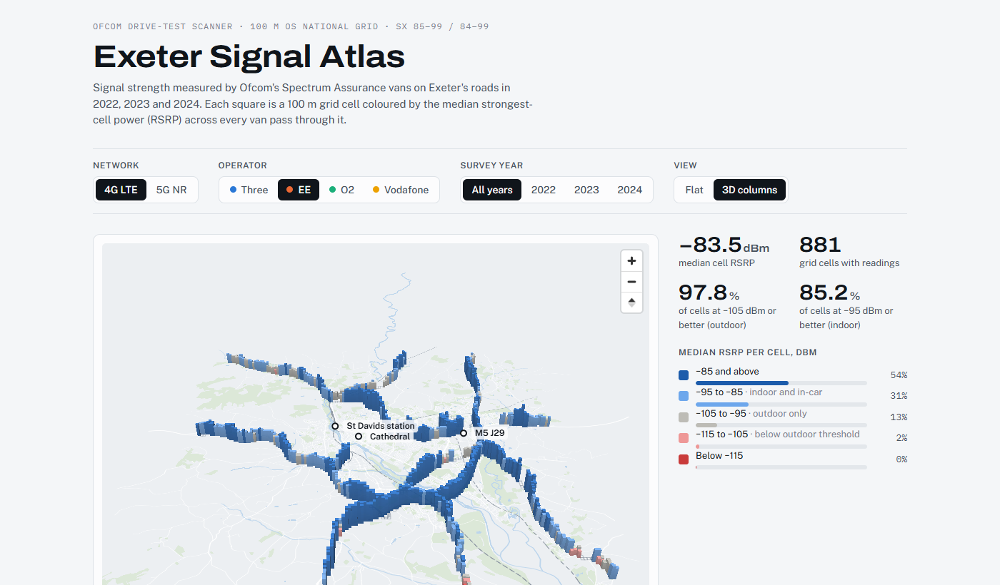

# Exeter Signal Atlas

Measured 4G and 5G signal strength on Exeter's roads, built from Ofcom's open drive-test data and shown as an interactive 3D map.

**[Live map](https://petersolan.github.io/Mobile-Signal-Strength/)**: switch network, operator and year, flat or in 3D.



*EE 4G, all survey years: each column is a 100 m square, its height and colour the median signal. Contains Ofcom data (OGL v3). Basemap © OpenStreetMap contributors.*

The map shows readings from Ofcom's Spectrum Assurance vans, taken during their regular work, for Three, EE, O2 and Vodafone in 2022, 2023 and 2024. Readings are binned to 100 m squares on the Ordnance Survey grid. You can switch between 4G and 5G, operator and survey year, view the squares flat or as 3D columns, and compare each operator against Ofcom's coverage thresholds.

## What the data shows

All survey years combined. Each square's value is its median RSRP (SS-RSRP for 5G). The thresholds are Ofcom's: for 4G, −105 dBm outdoor and −95 dBm indoor/in-car; for 5G, −110 dBm high confidence and −100 dBm very high confidence.

| Network | Operator | Squares | Median (dBm) | Squares at first threshold | Squares at second threshold |
|---|---|---|---|---|---|
| 4G | Vodafone | 883 | −81.7 | 98.4% | 88.9% |
| 4G | EE | 881 | −83.5 | 97.8% | 85.2% |
| 4G | O2 | 876 | −83.7 | 98.5% | 85.8% |
| 4G | Three | 878 | −89.6 | 94.4% | 70.2% |
| 5G | EE | 933 | −94.2 | 93.0% | 74.9% |
| 5G | Three | 870 | −110.2 | 49.0% | 22.0% |

- 4G is strong for all four operators, with medians between −82 and −90 dBm. Three is the weakest.
- 5G from EE is much stronger than from Three. EE mostly uses a lower frequency band (about 780 MHz), which travels further than Three's 3.6 GHz band.
- 2024 readings are a few dB stronger than 2022 for every operator, but 2024 had only about 3 hours of driving.

## Caveats

- The vans have roof-mounted antennas and Ofcom applies no correction for antenna gain. A phone inside a car or a building will see weaker signal.
- The vans drive for other work, not coverage surveys. Only roads they used are measured: about 8 hours in Oct–Nov 2022, 1 hour in Sep 2023 and 3 hours in Jul 2024.
- O2 and Vodafone 5G are missing. The scanners were not tuned to their 5G channels on the Exeter passes, so this says nothing about whether they have 5G there.
- In one 2022 stop the van was parked with the scanner running and logged about 480,000 5G readings in a single 100 m square. Each square's value is therefore the median of per-pass medians, so a parked van counts as one pass.

## Repository layout

```
scripts/
  config.py            study area bounding box, data paths, Ofcom release URLs
  download_ofcom.py    resumable download of the Ofcom drive-test zips (~7 GB)
  extract_bbox.py      streams each zip and keeps rows inside the Exeter bounding box
  fetch_basemap.py     OpenStreetMap roads, rail, water and parks via the Overpass API
  build_exeter_grid.py harmonises 4G/5G schemas, bins to the 100 m OS grid (EPSG:27700)
  build_map_layers.py  simplifies the basemap and writes the cells as WGS84 GeoJSON
  csv_to_parquet.py    optional: converts the national 2025 CSVs to Parquet with DuckDB
viz/
  atlas.template.html  the page (MapLibre GL JS 4.7.1)
  build_page.py        inlines the data and stylesheet into docs/index.html
data/derived/          committed outputs (see below)
docs/index.html        the built site, served by GitHub Pages
```

## Rebuilding

Requires Python 3.11+.

```bash
pip install -r requirements.txt
python scripts/download_ofcom.py      # ~7 GB; resumes if interrupted
python scripts/extract_bbox.py        # a few minutes per zip
python scripts/fetch_basemap.py
python scripts/build_exeter_grid.py
python scripts/build_map_layers.py
python viz/build_page.py              # writes docs/index.html
```

To study another area, change `BBOX` in `scripts/config.py`. Check that `RELEASES` includes the years with readings there; Ofcom's [drive route map](https://www.ofcom.org.uk/phones-and-broadband/coverage-and-speeds/drive-route-map) shows where the vans went.

## Outputs

| File | Contents |
|---|---|
| `data/derived/exeter_readings.parquet` | 1.33M cleaned readings: tech, year, operator, pass id, easting, northing, RSRP, SINR |
| `data/derived/exeter_grid_100m.gpkg` | 100 m cells (EPSG:27700) per tech, operator and year, with median RSRP/SINR, readings and passes; opens directly in QGIS |
| `data/derived/exeter_grid_100m.json` | compact grid layers used by the page's charts |
| `data/derived/exeter_map.json` | simplified OSM basemap and cell GeoJSON used by the map |

## Data sources and licences

Contains public sector information licensed under the [Open Government Licence v3.0](https://www.nationalarchives.gov.uk/doc/open-government-licence/version/3/).

- **Ofcom**, [mobile signal strength measurement data](https://www.ofcom.org.uk/phones-and-broadband/coverage-and-speeds/mobile-signal-strength-measurement-data) (4G LTE 2022–2024; 5G NR Oct–Dec 2022, Sep 2023 and 2024). The methodology PDF on that page defines the fields. In this repo the data is filtered to Exeter, cleaned, re-projected and aggregated to a 100 m grid.
- **Ofcom**, [Connected Nations 2025](https://www.ofcom.org.uk/phones-and-broadband/coverage-and-speeds/connected-nations-2025/data-downloads-2025): predicted coverage for Exeter local authority (E07000041), quoted on the page for comparison.
- **OpenStreetMap** basemap, © [OpenStreetMap contributors](https://www.openstreetmap.org/copyright). The simplified basemap in `data/derived/exeter_map.json` is a derivative database and is available under the [Open Database Licence](https://opendatacommons.org/licenses/odbl/1-0/).
- **MapLibre GL JS** renders the map. Its stylesheet is included under BSD-3-Clause; see `viz/MAPLIBRE-LICENSE.txt`.

This is an independent project. It is not produced, approved or endorsed by Ofcom or any mobile operator.

The code is MIT licensed. `LICENSE` sets out which files are covered by which licence.
