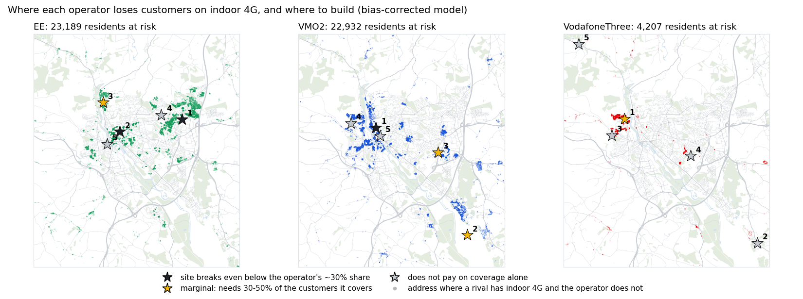

# Exeter Signal Atlas, Coverage Checker and Network Business Case

Measured 4G and 5G signal strength on Exeter's roads from Ofcom's open drive-test data, a coverage model built from it (masts estimated from the measurements, hills from LiDAR, calibrated and validated against the drive tests, counted against every resident's address), and a business case on top: where each operator loses customers to its rivals on indoor coverage, which gaps matter most, and which new sites would pay back.

- **[Business case](#business-case-coverage-gaps-opportunities-and-where-to-build)**: competitive gaps per neighbourhood, opportunity scoring with Census 2021, and a costed site plan per operator with break-even and sensitivity.
- **[Coverage checker](https://petersolan.github.io/Mobile-Signal-Strength/coverage.html)**: modelled 4G and 5G per operator, as coverage classes or dBm; residents with indoor 4G or good 5G in any area you pick or draw, with CSV export. [How it works](#coverage-checker-modelled).
- **[Signal Atlas](https://petersolan.github.io/Mobile-Signal-Strength/)**: the measurements themselves; switch network, operator and year, flat or in 3D.


*EE 4G, all survey years: each column is a 100 m square, its height and colour the median signal. Contains Ofcom data (OGL v3). Basemap © OpenStreetMap contributors.*

The map shows readings from Ofcom's Spectrum Assurance vans, taken during their regular work, for Three, EE, O2 and Vodafone in 2022, 2023 and 2024. Readings are binned to 100 m squares on the Ordnance Survey grid. You can switch between 4G and 5G, operator and survey year, view the squares flat or as 3D columns, and compare each operator against Ofcom's coverage thresholds.

## Business case: coverage gaps, opportunities and where to build

The coverage model answers *where is there signal*. This part answers the questions an operator's network and commercial teams ask next: **where are we losing customers to rivals, which of those places matter most, and what would it cost to fix them?** It covers Exeter and its edges (152,419 residents at 72,647 addresses, 21 neighbourhoods) for the three UK networks after the Vodafone-Three merger: **EE, VMO2 and VodafoneThree** (the better of the Vodafone and Three signals at each address, as the two networks are being combined).



*Bias-corrected scenario. Each dot is an address where a rival gives indoor 4G and the operator does not; stars are the recommended sites in build order, dark where they break even below the operator's ~30% market share. Basemap © OpenStreetMap contributors.*

### Findings

1. **VMO2 is the most exposed.** 9,400 to 22,900 residents have indoor 4G from a rival but not from VMO2, and almost nobody (84 to 380) has indoor 4G from VMO2 alone. A site at the **University or in Central Exeter pays back in both scenarios**, needing 9-18% of the customers it brings indoor coverage to, against a fair share of about 30%. **Recommendation: build.**
2. **EE's case depends on the model's bias.** As modelled, its best sites (Pinhoe & Whipton North, the University, Central Exeter) need 60-186% of the customers they cover, which does not pay; bias-corrected, the same places need 20-36%. **Recommendation: a targeted drive test in those three areas (a day of measurement) before committing about £750k.** It settles which scenario is right for a fraction of the cost.
3. **VodafoneThree should not build for coverage.** Its gaps are small and scattered: its one candidate, Exwick & Foxhayes, needs 93% of the customers it covers as modelled and 41% bias-corrected, above a fair share either way. Its opportunity is commercial: **2,000 to 5,200 residents get indoor 4G only from VodafoneThree**, where marketing rather than masts wins customers. Combining the two networks adds indoor 4G for 1,000 to 2,800 residents over Vodafone alone.
4. **The University area is the prize.** Half its residents are full-time students (Census 2021): heavy data users who choose a network every September. Once customers are weighted by value, it tops VMO2's opportunity list in both scenarios and EE's as modelled.

### Method

1. **Competitive gaps** (`scripts/gap_analysis.py`). Each address is classed for indoor 4G (Ofcom's -95 dBm) per operator. Per neighbourhood (MSOA): the share of residents with indoor 4G, the gap to the best rival, residents **at risk** (a rival covers them indoors, the operator does not) and residents **only this operator** covers. Indoor 4G only: the 5G model is measured for EE and Three alone, so 5G is left out of the comparison.
2. **Opportunity scoring** (`scripts/fetch_demographics.py`, `scripts/opportunity.py`). Census 2021 from the Nomis API (TS066 economic activity, TS007A age) per LSOA. **Customers** are adult residents; their **value** is the share employed or in full-time education, relative to the area average (the data-heavy, mostly pay-monthly customers). Two plays per operator: **defend** (at-risk customers: fix coverage) and **attack** (customers only it covers: market there), each scored as customers x value.
3. **Site plan** (`scripts/site_plan.py`). A new site is modelled like the operator's existing cells: terrain diffraction over the LiDAR surface, the operator's clutter loss and calibration, the median power and slope of its 4G cells below 1 GHz, which in Exeter are 800 MHz (LTE Band 20, the band that carries indoor coverage), a 25 m mast. Higher bands (1.8, 2.1 and 2.6 GHz) lose 7-10 dB more before walls and hills, so they add capacity rather than reach indoor not-spots. Candidates sit on a 250 m grid near at-risk customers; five sites per operator are chosen greedily by value-weighted customers gained, so each next site only counts what the earlier ones did not cover.
4. **Break-even.** No public data says how many newly covered people switch or stay, so instead of guessing it each site gets the number it must win or keep to pay back in 5 years, as a share of the customers it covers. Below the operator's fair share (~30%) is plausible; above it, the site needs more than coverage to justify it.

### Results

**Indoor 4G and residents at risk**, as modelled / bias-corrected (see [Model vs drive tests](#model-vs-drive-tests)):

| Operator | Indoor 4G | At risk: a rival covers them indoors, the operator does not | Only this operator covers them indoors |
|---|---|---|---|
| EE | 95.6% / 83.2% | 5,935 / 23,189 | 1,049 / 2,355 |
| VMO2 | 93.3% / 83.4% | 9,429 / 22,932 | 84 / 380 |
| VodafoneThree | 98.2% / 95.7% | 1,964 / 4,207 | 1,953 / 5,221 |
| *Vodafone before the merger* | *97.5% / 93.8%* | *2,959 / 6,765* | *1,924 / 4,967* |

No operator gives indoor 4G to 795 / 2,374 residents, mostly at the rural edges.

**Opportunities**: adult customers to defend and to attack, as modelled / bias-corrected:

| Operator | Defend (customers) | Attack (customers) | Top defend areas |
|---|---|---|---|
| EE | 5,120 / 19,736 | 864 / 1,908 | Pennsylvania & University; Central Exeter; Pinhoe & Whipton North |
| VMO2 | 8,419 / 19,900 | 72 / 335 | Pennsylvania & University; Central Exeter; Exwick & Foxhayes |
| VodafoneThree | 1,615 / 3,454 | 1,795 / 4,716 | Exwick & Foxhayes |

**Recommended sites**: the places that come out in both scenarios (within about 500 m), the customers each would bring indoor coverage to (as modelled / bias-corrected), and the share of them it must win or keep to pay back in 5 years:

| Operator | Site area | Customers covered | Break-even share, as modelled | Break-even share, bias-corrected |
|---|---|---|---|---|
| VMO2 | Pennsylvania & University | 5,404 / 1,568 | **17.5%** (1st) | 60.2% (4th) |
| VMO2 | Central Exeter | 603 / 10,729 | 156.6% (3rd) | **8.8%** (1st) |
| VMO2 | Countess Wear & Topsham | 1,472 / 3,035 | 64.1% | 31.1% |
| EE | Pinhoe & Whipton North | 1,404 / 4,748 | 67.2% | **19.9%** |
| EE | Pennsylvania & University | 1,588 / 2,634 | 59.5% | 35.8% |
| EE | Central Exeter | 508 / 3,727 | 185.8% | **25.3%** |
| VodafoneThree | Exwick & Foxhayes | 1,014 / 2,284 | 93.1% | 41.3% |

VMO2's University and Central Exeter sites overlap: whichever is built first takes most of the other's customers, so one of the two is the build in either scenario. The full lists are in `data/derived/site_plan.csv`.

**Assumptions and sensitivity.** ARPU £13.24 a month (Ofcom, all UK mobile subscribers, Q4 2025), a 50% margin after the cost of serving a subscriber (an assumption), £250k for a new macro site, all in: finding and acquiring the site, planning permission, power, backhaul, the build and the people planning it. That is the low end of the £250k-750k a new UK site typically costs, depending on location; Ofcom's cost model, about £150k in today's prices, counts mainly equipment and construction, and government-funded rural masts have cost about £478k. Running it costs 10% of that a year. Subscribers a site must win or keep to pay back in 5 years:

| Site cost | ARPU £10 | ARPU £13.24 | ARPU £18 |
|---|---|---|---|
| £250k | 1,250 | **944** | 694 |
| £500k | 2,500 | 1,888 | 1,389 |
| £750k | 3,750 | 2,832 | 2,083 |

At the top of the range, VMO2's Central Exeter site still pays if the bias correction holds (2,832 of 10,729 customers, 26%), but its University site as modelled does not (52% of 5,404). So for a hard, expensive site the drive test comes first for VMO2 too; at a typical £250k it is a build.

### Model vs drive tests

Does the modelled coverage match the measurements? On the held-out 1 km squares of the validation below (the model refitted without them), the share of 20 m road squares with indoor-level 4G (`scripts/coverage_match.py`):

| Operator | Measured | Modelled | Same coverage class | Model better than measured | Model worse |
|---|---|---|---|---|---|
| EE | 87.6% | 98.4% | 87% | 12% | 1% |
| O2 (VMO2) | 80.7% | 89.4% | 80% | 15% | 6% |
| Vodafone | 85.5% | 84.0% | 81% | 9% | 10% |
| Three | 65.5% | 73.6% | 78% | 15% | 7% |

The model gets the class right in 78-87% of places it has not seen, but it overstates indoor coverage by 8-11 points for EE, O2 and Three: it reproduces the typical signal, not the deepest shadows behind hills and buildings. So every result above is given twice: **as modelled**, and **bias-corrected**, with each operator's 4G lowered by its mean error on the held-out areas (EE 6.3 dB, Three 4.8, O2 4.8, Vodafone 3.9). As modelled, the gaps are lower bounds; the bias-corrected figures sit closer to the drive tests. The two scenarios agree on where to build and on the order of the operators; they differ on how much is at stake.

### Limits

- Coverage is modelled from 2022-2024 drive tests on public roads, with estimated mast positions and no antenna patterns; it is an estimate from open data, not an operator's coverage map.
- Market share and ARPU are national figures; there is no public local data. The margin is an assumption. New sites are modelled as one 4G 800 MHz site with the operator's median cell, without the random shadow fading of the coverage grid, so customers gained are upper estimates. Capacity, 5G and fixed wireless are not included.
- Census 2021 counts students at their term-time address, which is what this question needs. Some edge neighbourhoods are only partly inside the study area.

## What the data shows

All survey years combined. Each square's value is its median RSRP (SS-RSRP for 5G). The thresholds are Ofcom's: for 4G, −105 dBm outdoor and −95 dBm indoor/in-car; for 5G, −110 dBm high confidence and −100 dBm very high confidence.

| Network | Operator | Squares | Median (dBm) | Squares at first threshold | Squares at second threshold |
|---|---|---|---|---|---|
| 4G | Vodafone | 883 | −81.7 | 98.4% | 88.9% |
| 4G | EE | 881 | −83.5 | 97.8% | 85.2% |
| 4G | O2 | 876 | −83.7 | 98.5% | 85.8% |
| 4G | Three | 878 | −89.6 | 94.4% | 70.2% |
| 5G | EE | 933 | −94.2 | 93.0% | 74.9% |
| 5G | Three | 870 | −110.2 | 49.0% | 22.0% |

- 4G is strong for all four operators, with medians between −82 and −90 dBm. Three is the weakest.
- 5G from EE is much stronger than from Three. EE mostly uses a lower frequency band (about 780 MHz), which travels further than Three's 3.6 GHz band.
- 2024 readings are a few dB stronger than 2022 for every operator, but 2024 had only about 3 hours of driving.

## Caveats

- The vans have roof-mounted antennas and Ofcom applies no correction for antenna gain. A phone inside a car or a building will see weaker signal.
- The vans drive for other work, not coverage surveys. Only roads they used are measured: about 8 hours in Oct–Nov 2022, 1 hour in Sep 2023 and 3 hours in Jul 2024.
- O2 and Vodafone 5G are missing. The scanners were not tuned to their 5G channels on the Exeter passes, so this says nothing about whether they have 5G there.
- In one 2022 stop the van was parked with the scanner running and logged about 480,000 5G readings in a single 100 m square. Each square's value is therefore the median of per-pass medians, so a parked van counts as one pass.

## Coverage checker (modelled)

**[Coverage checker](https://petersolan.github.io/Mobile-Signal-Strength/coverage.html)**: the drive tests only measure roads. The checker models 4G and 5G coverage everywhere in between, with hills from LiDAR, and counts how many residents get indoor 4G or good 5G, from which operator, in any area: a local authority, a neighbourhood (MSOA), or one you draw. It shows coverage classes or the signal in dBm, the table downloads as CSV, and the page prints as a report. It covers EE, VMO2 (Virgin Media O2) and Vodafone: Three is now part of VodafoneThree, so it is left out of the checker, though its readings still feed the calibration and stay in the Signal Atlas.


*Modelled 4G across Exeter, coloured by how many of the three operators give indoor coverage; the tooltip shows each operator's modelled signal at that point, and the readout counts Exeter's residents.*

How it works:

1. **Cells and masts from the drive tests.** Every 4G reading lists each operator's four strongest cells (PCI and EARFCN) with their RSRP: 740 cells across the four networks. For each cell seen often and strongly enough (531), a path-loss curve `RSRP = A − 10·n·log10(d)` is fitted to its readings, binned to 20 m squares, with a robust (soft L1) least-squares fit and the slope n held to the urban macro range 2.8–4.5. This estimates where its mast is and how strong it is. Positions from road readings are approximate, typically a few hundred metres off: OpenStreetMap maps only 34 masts in the area, too few to check them against.
2. **Hills and buildings.** Environment Agency 1 m LiDAR, averaged to 5 m. From each mast, rays every 0.5° sample the terrain every 20 m; a point below the horizon loses signal by knife-edge diffraction (ITU-R P.526) at the cell's own frequency, so 3.6 GHz drops behind a hill that 800 MHz gets over. Buildings and trees enter as clutter, the mean height of everything within about 150 m, with a loss per metre fitted to the drive tests for each operator. Each cell's power is refitted with the diffraction loss included.
3. **5G.** Most 5G readings are not tied to a cell (the PCI is on other rows), so 5G is modelled the way it is rolled out: a 5G cell on each of the operator's estimated masts at its 5G frequency (EE mostly 700 MHz, from the NR-ARFCNs), calibrated to the measured strongest-cell SS-RSRP. VMO2 and Vodafone 5G was not scanned in Exeter, so theirs is **synthetic**: 3.5 GHz on all their estimated masts, calibrated to the 3.6 GHz 5G measured on Three's network, and labelled as synthetic everywhere.
4. **Coverage grid.** On a 25 m OS grid, an operator's coverage is its strongest modelled cell, shifted by the operator's median difference from the measurements. Near the roads, the remaining measured − modelled difference is spread over about 150 m, so the grid matches the drive tests there. Away from them, a smooth random field (shadow fading: ±4 dB for 4G, ±6 dB for 5G, about 50 m across, 60% shared between operators because the same trees and buildings get in everyone's way) stands in for what the LiDAR cannot explain. It is one fixed draw, not a measurement.
5. **Residents.** Census 2021 residents per address (UPRN), from the [Census-distribution](https://github.com/petersolan/GB-Census-Population-Map) project: 152,419 residents at 72,647 addresses, 130,712 of them in Exeter. Each address takes the modelled RSRP of its 25 m square and is classed with Ofcom's thresholds: 4G indoor at −95 dBm or more and outdoor from −105 dBm; 5G very high confidence at −100 dBm and high from −110 dBm.

**Validation.** One in five 1 km squares (16 of 81) is held out, the cells are refitted and the calibration rebuilt without their readings, and the held-out squares are predicted (before the random field). Held-out areas rather than passes, because the vans drive the same roads repeatedly.

| Network | Operator | Bias, dB | RMSE, dB | Same coverage class |
|---|---|---|---|---|
| 4G | EE | +6.3 | 14.8 | 87% |
| 4G | VMO2 | +4.8 | 13.6 | 79% |
| 4G | Vodafone | +3.9 | 12.8 | 81% |
| 5G | EE | +0.1 | 12.1 | 64% |

With the road correction; the model alone is 16–20 dB RMSE. Tuned propagation models typically reach 8–10 dB. The positive bias means the model is a few dB optimistic in areas it has not seen. Letting the slope run free fits the roads slightly better (8.5–14.3 dB) but with free-space curves that throw kilometre-wide hotspots, so the slope is held to the urban range.

**Modelled coverage of Exeter's residents**

| Operator | 4G indoor | 4G outdoor only | 5G very high confidence | 5G high | No 5G |
|---|---|---|---|---|---|
| EE | 96.6% | 3.3% | 85.0% | 13.5% | 1.5% |
| Vodafone | 98.1% | 1.8% | 26.4%* | 35.7%* | 37.8%* |
| VMO2 | 94.1% | 5.2% | 33.9%* | 26.3%* | 39.8%* |

\* synthetic 5G.

90.8% of residents have indoor 4G from all three operators. Ofcom's Connected Nations 2025, from the operators' own predictions, gives 99.9% of premises with indoor 4G from at least three of its four operators, so this model is the more cautious of the two: mast positions are estimates, there are no antenna patterns, the drive tests are from 2022–2024, and the scanner's roof antenna gain is not corrected. Both agree that practically every home has indoor 4G from at least one operator (99.9% here, 100% in Ofcom's figures). Use the checker as an estimate from open data, not as an operator's coverage map.

## Repository layout

```
scripts/
  config.py            study area bounding box, data paths, Ofcom release URLs
  download_ofcom.py    resumable download of the Ofcom drive-test zips (~7 GB)
  extract_bbox.py      streams each zip and keeps rows inside the Exeter bounding box
  fetch_basemap.py     OpenStreetMap roads, rail, water and parks via the Overpass API
  build_exeter_grid.py harmonises 4G/5G schemas, bins to the 100 m OS grid (EPSG:27700)
  build_map_layers.py  simplifies the basemap and writes the cells as WGS84 GeoJSON
  csv_to_parquet.py    optional: converts the national 2025 CSVs to Parquet with DuckDB
  estimate_cells.py    fits a path-loss curve per 4G cell: estimated mast positions
  prepare_surface.py   5 m ground and surface heights from EA LiDAR
  propagation.py       terrain rays and knife-edge diffraction
  extract_addresses.py Census 2021 residents per address in the study area
  build_coverage.py    coverage grids per operator, held-out validation, residents per class
  coverage_match.py    held-out coverage classes, measured vs modelled
  gap_analysis.py      competitive gaps per neighbourhood and operator, two scenarios
  fetch_demographics.py  Census 2021 profile per LSOA from the Nomis API
  opportunity.py       defend / attack customers, weighted by value
  site_plan.py         new sites per operator, greedy choice, break-even and sensitivity
viz/
  atlas.template.html  the Signal Atlas page (MapLibre GL JS 4.7.1)
  build_page.py        inlines the data and stylesheet into docs/index.html
  coverage.template.html, build_coverage_page.py   the coverage checker, docs/coverage.html
  build_business_case_map.py                       the business case map, docs/images/business_case.png
data/derived/          committed outputs (see below)
docs/                  the built site, served by GitHub Pages
```

## Rebuilding

Requires Python 3.11+.

```bash
pip install -r requirements.txt
python scripts/download_ofcom.py      # ~7 GB; resumes if interrupted
python scripts/extract_bbox.py        # a few minutes per zip
python scripts/fetch_basemap.py
python scripts/build_exeter_grid.py
python scripts/build_map_layers.py
python viz/build_page.py              # writes docs/index.html

# coverage checker (needs the Census-distribution outputs next to this repo, see scripts/config.py)
python scripts/extract_addresses.py
python scripts/prepare_surface.py     # needs the Exeter 3D City Model LiDAR tiles, see scripts/config.py
python scripts/build_coverage.py      # ~10 minutes, including the validation
python viz/build_coverage_page.py     # writes docs/coverage.html

# business case (after the coverage checker)
python scripts/coverage_match.py      # ~5 minutes
python scripts/gap_analysis.py
python scripts/fetch_demographics.py  # Census 2021 from the Nomis API
python scripts/opportunity.py
python scripts/site_plan.py           # ~10 minutes
python viz/build_business_case_map.py
```

`scripts/estimate_cells.py` on its own writes the fitted cells and grouped sites as GeoPackages for QGIS.

To study another area, change `BBOX` in `scripts/config.py`. Check that `RELEASES` includes the years with readings there; Ofcom's [drive route map](https://www.ofcom.org.uk/phones-and-broadband/coverage-and-speeds/drive-route-map) shows where the vans went.

## Outputs

| File | Contents |
|---|---|
| `data/derived/exeter_readings.parquet` | 1.33M cleaned readings: tech, year, operator, pass id, easting, northing, RSRP, SINR |
| `data/derived/exeter_grid_100m.gpkg` | 100 m cells (EPSG:27700) per tech, operator and year, with median RSRP/SINR, readings and passes; opens directly in QGIS |
| `data/derived/exeter_grid_100m.json` | compact grid layers used by the page's charts |
| `data/derived/exeter_map.json` | simplified OSM basemap and cell GeoJSON used by the map |
| `data/derived/coverage_<4g\|5g>_<operator>.tif` | modelled RSRP (dBm; SS-RSRP for 5G) on a 25 m grid, EPSG:27700 |
| `data/derived/coverage_cells.csv` | modelled 4G cells and 5G sites: estimated position, antenna height, frequency, A and n |
| `data/derived/coverage_validation.csv` | held-out errors per operator, model only and with the road correction |
| `data/derived/coverage_summary.csv` | residents per modelled coverage class by network and local authority |
| `data/derived/coverage_match.csv` | held-out road squares per 4G coverage class, measured and modelled, per operator |
| `data/derived/gap_msoa.csv`, `gap_summary.csv` | indoor 4G, gap to the best rival, residents at risk and only-operator residents, per scenario, MSOA and operator |
| `data/derived/lsoa_demographics.csv` | Census 2021 adults, employed, full-time students and retired per LSOA |
| `data/derived/opportunity_msoa.csv` | defend and attack customers and scores per scenario, MSOA and operator |
| `data/derived/site_plan.csv`, `site_sensitivity.csv` | recommended sites per operator and scenario with customers gained and break-even; break-even by site cost and ARPU |

## Data sources and licences

Contains public sector information licensed under the [Open Government Licence v3.0](https://www.nationalarchives.gov.uk/doc/open-government-licence/version/3/).

- **Ofcom**, [mobile signal strength measurement data](https://www.ofcom.org.uk/phones-and-broadband/coverage-and-speeds/mobile-signal-strength-measurement-data) (4G LTE 2022–2024; 5G NR Oct–Dec 2022, Sep 2023 and 2024). The methodology PDF on that page defines the fields. In this repo the data is filtered to Exeter, cleaned, re-projected and aggregated to a 100 m grid.
- **Ofcom**, [Connected Nations 2025](https://www.ofcom.org.uk/phones-and-broadband/coverage-and-speeds/connected-nations-2025/data-downloads-2025): predicted coverage for Exeter local authority (E07000041), quoted on the page for comparison.
- **Environment Agency** LiDAR composite DTM and first-return DSM, 1 m (OGL), for terrain and clutter.
- **ONS** Census 2021 and ONS UPRN Directory, via residents per address prepared in the Census-distribution project (OGL; contains OS data © Crown copyright and database right). **House of Commons Library** [MSOA names](https://houseofcommonslibrary.github.io/msoanames/) (OGL).
- **ONS** Census 2021 tables TS066 (economic activity) and TS007A (age) per LSOA, from the [Nomis API](https://www.nomisweb.co.uk/) (OGL).
- Business case figures: Ofcom's average mobile revenue per subscriber, Q4 2025 (as reported by [TelecomLead](https://telecomlead.com/?p=125511)); Ofcom's spectrum liberalisation [cost model](https://www.ofcom.org.uk/siteassets/resources/documents/consultations/uncategorised/8403-spectrumlib/summary/annexes/annex15.pdf) for site capex and opex; the DCMS [Mobile Infrastructure Project report](https://assets.publishing.service.gov.uk/media/5a82eb5aed915d74e62384b3/MIP_Impact_and_Benefits_Report.pdf) for the cost of government-funded masts.
- **OpenStreetMap** basemap, © [OpenStreetMap contributors](https://www.openstreetmap.org/copyright). The simplified basemap in `data/derived/exeter_map.json` is a derivative database and is available under the [Open Database Licence](https://opendatacommons.org/licenses/odbl/1-0/).
- **MapLibre GL JS** renders the map. Its stylesheet is included under BSD-3-Clause; see `viz/MAPLIBRE-LICENSE.txt`.

This is an independent project. It is not produced, approved or endorsed by Ofcom or any mobile operator.

The code is MIT licensed. `LICENSE` sets out which files are covered by which licence.
