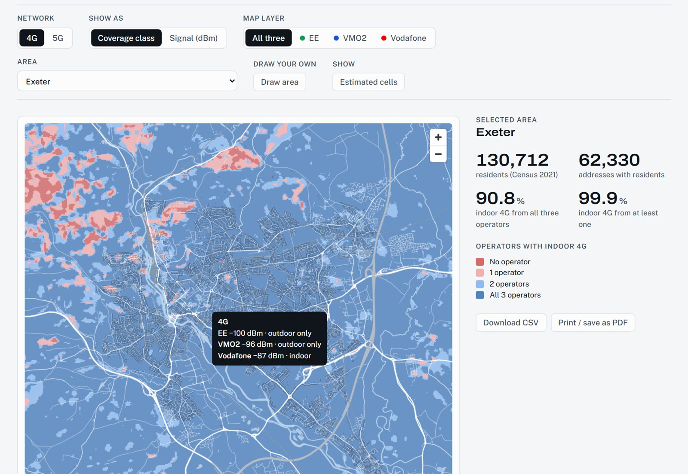

# Exeter Signal Atlas and Coverage Checker

Measured 4G and 5G signal strength on Exeter's roads from Ofcom's open drive-test data, and a coverage model built from it: masts estimated from the measurements, hills from LiDAR, calibrated and validated against the drive tests, and counted against every resident's address.

- **[Coverage checker](https://petersolan.github.io/Mobile-Signal-Strength/coverage.html)**: modelled 4G and 5G per operator, as coverage classes or dBm; residents with indoor 4G or good 5G in any area you pick or draw, with CSV export. [How it works](#coverage-checker-modelled).
- **[Signal Atlas](https://petersolan.github.io/Mobile-Signal-Strength/)**: the measurements themselves; switch network, operator and year, flat or in 3D.


*EE 4G, all survey years: each column is a 100 m square, its height and colour the median signal. Contains Ofcom data (OGL v3). Basemap © OpenStreetMap contributors.*

The map shows readings from Ofcom's Spectrum Assurance vans, taken during their regular work, for Three, EE, O2 and Vodafone in 2022, 2023 and 2024. Readings are binned to 100 m squares on the Ordnance Survey grid. You can switch between 4G and 5G, operator and survey year, view the squares flat or as 3D columns, and compare each operator against Ofcom's coverage thresholds.

## What the data shows

All survey years combined. Each square's value is its median RSRP (SS-RSRP for 5G). The thresholds are Ofcom's: for 4G, −105 dBm outdoor and −95 dBm indoor/in-car; for 5G, −110 dBm high confidence and −100 dBm very high confidence.

| Network | Operator | Squares | Median (dBm) | Squares at first threshold | Squares at second threshold |
|---|---|---|---|---|---|
| 4G | Vodafone | 883 | −81.7 | 98.4% | 88.9% |
| 4G | EE | 881 | −83.5 | 97.8% | 85.2% |
| 4G | O2 | 876 | −83.7 | 98.5% | 85.8% |
| 4G | Three | 878 | −89.6 | 94.4% | 70.2% |
| 5G | EE | 933 | −94.2 | 93.0% | 74.9% |
| 5G | Three | 870 | −110.2 | 49.0% | 22.0% |

- 4G is strong for all four operators, with medians between −82 and −90 dBm. Three is the weakest.
- 5G from EE is much stronger than from Three. EE mostly uses a lower frequency band (about 780 MHz), which travels further than Three's 3.6 GHz band.
- 2024 readings are a few dB stronger than 2022 for every operator, but 2024 had only about 3 hours of driving.

## Caveats

- The vans have roof-mounted antennas and Ofcom applies no correction for antenna gain. A phone inside a car or a building will see weaker signal.
- The vans drive for other work, not coverage surveys. Only roads they used are measured: about 8 hours in Oct–Nov 2022, 1 hour in Sep 2023 and 3 hours in Jul 2024.
- O2 and Vodafone 5G are missing. The scanners were not tuned to their 5G channels on the Exeter passes, so this says nothing about whether they have 5G there.
- In one 2022 stop the van was parked with the scanner running and logged about 480,000 5G readings in a single 100 m square. Each square's value is therefore the median of per-pass medians, so a parked van counts as one pass.

## Coverage checker (modelled)

**[Coverage checker](https://petersolan.github.io/Mobile-Signal-Strength/coverage.html)**: the drive tests only measure roads. The checker models 4G and 5G coverage everywhere in between, with hills from LiDAR, and counts how many residents get indoor 4G or good 5G, from which operator, in any area: a local authority, a neighbourhood (MSOA), or one you draw. It shows coverage classes or the signal in dBm, the table downloads as CSV, and the page prints as a report. It covers EE, VMO2 (Virgin Media O2) and Vodafone: Three is now part of VodafoneThree, so it is left out of the checker, though its readings still feed the calibration and stay in the Signal Atlas.



*Modelled 4G across Exeter, coloured by how many of the three operators give indoor coverage; the tooltip shows each operator's modelled signal at that point, and the readout counts Exeter's residents.*

How it works:

1. **Cells and masts from the drive tests.** Every 4G reading lists each operator's four strongest cells (PCI and EARFCN) with their RSRP: 740 cells across the four networks. For each cell seen often and strongly enough (531), a path-loss curve `RSRP = A − 10·n·log10(d)` is fitted to its readings, binned to 20 m squares, with a robust (soft L1) least-squares fit and the slope n held to the urban macro range 2.8–4.5. This estimates where its mast is and how strong it is. Positions from road readings are approximate, typically a few hundred metres off: OpenStreetMap maps only 34 masts in the area, too few to check them against.
2. **Hills and buildings.** Environment Agency 1 m LiDAR, averaged to 5 m. From each mast, rays every 0.5° sample the terrain every 20 m; a point below the horizon loses signal by knife-edge diffraction (ITU-R P.526) at the cell's own frequency, so 3.6 GHz drops behind a hill that 800 MHz gets over. Buildings and trees enter as clutter, the mean height of everything within about 150 m, with a loss per metre fitted to the drive tests for each operator. Each cell's power is refitted with the diffraction loss included.
3. **5G.** Most 5G readings are not tied to a cell (the PCI is on other rows), so 5G is modelled the way it is rolled out: a 5G cell on each of the operator's estimated masts at its 5G frequency (EE mostly 700 MHz, from the NR-ARFCNs), calibrated to the measured strongest-cell SS-RSRP. VMO2 and Vodafone 5G was not scanned in Exeter, so theirs is **synthetic**: 3.5 GHz on all their estimated masts, calibrated to the 3.6 GHz 5G measured on Three's network, and labelled as synthetic everywhere.
4. **Coverage grid.** On a 25 m OS grid, an operator's coverage is its strongest modelled cell, shifted by the operator's median difference from the measurements. Near the roads, the remaining measured − modelled difference is spread over about 150 m, so the grid matches the drive tests there. Away from them, a smooth random field (shadow fading: ±4 dB for 4G, ±6 dB for 5G, about 50 m across, 60% shared between operators because the same trees and buildings get in everyone's way) stands in for what the LiDAR cannot explain. It is one fixed draw, not a measurement.
5. **Residents.** Census 2021 residents per address (UPRN), from the [Census-distribution](https://github.com/petersolan/GB-Census-Population-Map) project: 152,419 residents at 72,647 addresses, 130,712 of them in Exeter. Each address takes the modelled RSRP of its 25 m square and is classed with Ofcom's thresholds: 4G indoor at −95 dBm or more and outdoor from −105 dBm; 5G very high confidence at −100 dBm and high from −110 dBm.

**Validation.** One in five 1 km squares (16 of 81) is held out, the cells are refitted and the calibration rebuilt without their readings, and the held-out squares are predicted (before the random field). Held-out areas rather than passes, because the vans drive the same roads repeatedly.

| Network | Operator | Bias, dB | RMSE, dB | Same coverage class |
|---|---|---|---|---|
| 4G | EE | +6.3 | 14.8 | 87% |
| 4G | VMO2 | +4.8 | 13.6 | 79% |
| 4G | Vodafone | +3.9 | 12.8 | 81% |
| 5G | EE | +0.1 | 12.1 | 64% |

With the road correction; the model alone is 16–20 dB RMSE. Tuned propagation models typically reach 8–10 dB. The positive bias means the model is a few dB optimistic in areas it has not seen. Letting the slope run free fits the roads slightly better (8.5–14.3 dB) but with free-space curves that throw kilometre-wide hotspots, so the slope is held to the urban range.

**Modelled coverage of Exeter's residents**

| Operator | 4G indoor | 4G outdoor only | 5G very high confidence | 5G high | No 5G |
|---|---|---|---|---|---|
| EE | 96.6% | 3.3% | 85.0% | 13.5% | 1.5% |
| Vodafone | 98.1% | 1.8% | 25.1%* | 34.8%* | 40.1%* |
| VMO2 | 94.1% | 5.2% | 32.6%* | 26.0%* | 41.4%* |

\* synthetic 5G.

90.8% of residents have indoor 4G from all three operators. Ofcom's Connected Nations 2025, from the operators' own predictions, gives 99.9% of premises with indoor 4G from at least three of its four operators, so this model is the more cautious of the two: mast positions are estimates, there are no antenna patterns, the drive tests are from 2022–2024, and the scanner's roof antenna gain is not corrected. Both agree that practically every home has indoor 4G from at least one operator (99.9% here, 100% in Ofcom's figures). Use the checker as an estimate from open data, not as an operator's coverage map.

## Repository layout

```
scripts/
  config.py            study area bounding box, data paths, Ofcom release URLs
  download_ofcom.py    resumable download of the Ofcom drive-test zips (~7 GB)
  extract_bbox.py      streams each zip and keeps rows inside the Exeter bounding box
  fetch_basemap.py     OpenStreetMap roads, rail, water and parks via the Overpass API
  build_exeter_grid.py harmonises 4G/5G schemas, bins to the 100 m OS grid (EPSG:27700)
  build_map_layers.py  simplifies the basemap and writes the cells as WGS84 GeoJSON
  csv_to_parquet.py    optional: converts the national 2025 CSVs to Parquet with DuckDB
  estimate_cells.py    fits a path-loss curve per 4G cell: estimated mast positions
  prepare_surface.py   5 m ground and surface heights from EA LiDAR
  propagation.py       terrain rays and knife-edge diffraction
  extract_addresses.py Census 2021 residents per address in the study area
  build_coverage.py    coverage grids per operator, held-out validation, residents per class
viz/
  atlas.template.html  the Signal Atlas page (MapLibre GL JS 4.7.1)
  build_page.py        inlines the data and stylesheet into docs/index.html
  coverage.template.html, build_coverage_page.py   the coverage checker, docs/coverage.html
data/derived/          committed outputs (see below)
docs/                  the built site, served by GitHub Pages
```

## Rebuilding

Requires Python 3.11+.

```bash
pip install -r requirements.txt
python scripts/download_ofcom.py      # ~7 GB; resumes if interrupted
python scripts/extract_bbox.py        # a few minutes per zip
python scripts/fetch_basemap.py
python scripts/build_exeter_grid.py
python scripts/build_map_layers.py
python viz/build_page.py              # writes docs/index.html

# coverage checker (needs the Census-distribution outputs next to this repo, see scripts/config.py)
python scripts/extract_addresses.py
python scripts/prepare_surface.py     # needs the Exeter 3D City Model LiDAR tiles, see scripts/config.py
python scripts/build_coverage.py      # ~10 minutes, including the validation
python viz/build_coverage_page.py     # writes docs/coverage.html
```

`scripts/estimate_cells.py` on its own writes the fitted cells and grouped sites as GeoPackages for QGIS.

To study another area, change `BBOX` in `scripts/config.py`. Check that `RELEASES` includes the years with readings there; Ofcom's [drive route map](https://www.ofcom.org.uk/phones-and-broadband/coverage-and-speeds/drive-route-map) shows where the vans went.

## Outputs

| File | Contents |
|---|---|
| `data/derived/exeter_readings.parquet` | 1.33M cleaned readings: tech, year, operator, pass id, easting, northing, RSRP, SINR |
| `data/derived/exeter_grid_100m.gpkg` | 100 m cells (EPSG:27700) per tech, operator and year, with median RSRP/SINR, readings and passes; opens directly in QGIS |
| `data/derived/exeter_grid_100m.json` | compact grid layers used by the page's charts |
| `data/derived/exeter_map.json` | simplified OSM basemap and cell GeoJSON used by the map |
| `data/derived/coverage_<4g\|5g>_<operator>.tif` | modelled RSRP (dBm; SS-RSRP for 5G) on a 25 m grid, EPSG:27700 |
| `data/derived/coverage_cells.csv` | modelled 4G cells and 5G sites: estimated position, antenna height, frequency, A and n |
| `data/derived/coverage_validation.csv` | held-out errors per operator, model only and with the road correction |
| `data/derived/coverage_summary.csv` | residents per modelled coverage class by network and local authority |

## Data sources and licences

Contains public sector information licensed under the [Open Government Licence v3.0](https://www.nationalarchives.gov.uk/doc/open-government-licence/version/3/).

- **Ofcom**, [mobile signal strength measurement data](https://www.ofcom.org.uk/phones-and-broadband/coverage-and-speeds/mobile-signal-strength-measurement-data) (4G LTE 2022–2024; 5G NR Oct–Dec 2022, Sep 2023 and 2024). The methodology PDF on that page defines the fields. In this repo the data is filtered to Exeter, cleaned, re-projected and aggregated to a 100 m grid.
- **Ofcom**, [Connected Nations 2025](https://www.ofcom.org.uk/phones-and-broadband/coverage-and-speeds/connected-nations-2025/data-downloads-2025): predicted coverage for Exeter local authority (E07000041), quoted on the page for comparison.
- **Environment Agency** LiDAR composite DTM and first-return DSM, 1 m (OGL), for terrain and clutter.
- **ONS** Census 2021 and ONS UPRN Directory, via residents per address prepared in the Census-distribution project (OGL; contains OS data © Crown copyright and database right). **House of Commons Library** [MSOA names](https://houseofcommonslibrary.github.io/msoanames/) (OGL).
- **OpenStreetMap** basemap, © [OpenStreetMap contributors](https://www.openstreetmap.org/copyright). The simplified basemap in `data/derived/exeter_map.json` is a derivative database and is available under the [Open Database Licence](https://opendatacommons.org/licenses/odbl/1-0/).
- **MapLibre GL JS** renders the map. Its stylesheet is included under BSD-3-Clause; see `viz/MAPLIBRE-LICENSE.txt`.

This is an independent project. It is not produced, approved or endorsed by Ofcom or any mobile operator.

The code is MIT licensed. `LICENSE` sets out which files are covered by which licence.
